# MLOps Assignment 2: Containerizing an ML Prediction Service

**Name:** Sharaz Masih  **Roll Number:** 22F-3425  **Section:** BSCS 9A

- **GitHub repository:** <https://github.com/Sharazsony/breast-cancer-triage-service>
- **Docker Hub repository:** <https://hub.docker.com/r/sharaz123/breast-cancer-triage-api>
  (tags `1.0.0` and `latest`, public)

Every screenshot shows the command that was run together with its real output. The raw
text of each one is in [`docs/logs/`](logs/) with the same file name.

---

# Milestone 0: Docker CLI Fundamentals

## Task 1: Installation and First Container

Client and Engine both report version 29.1.3, with Docker Compose v2.

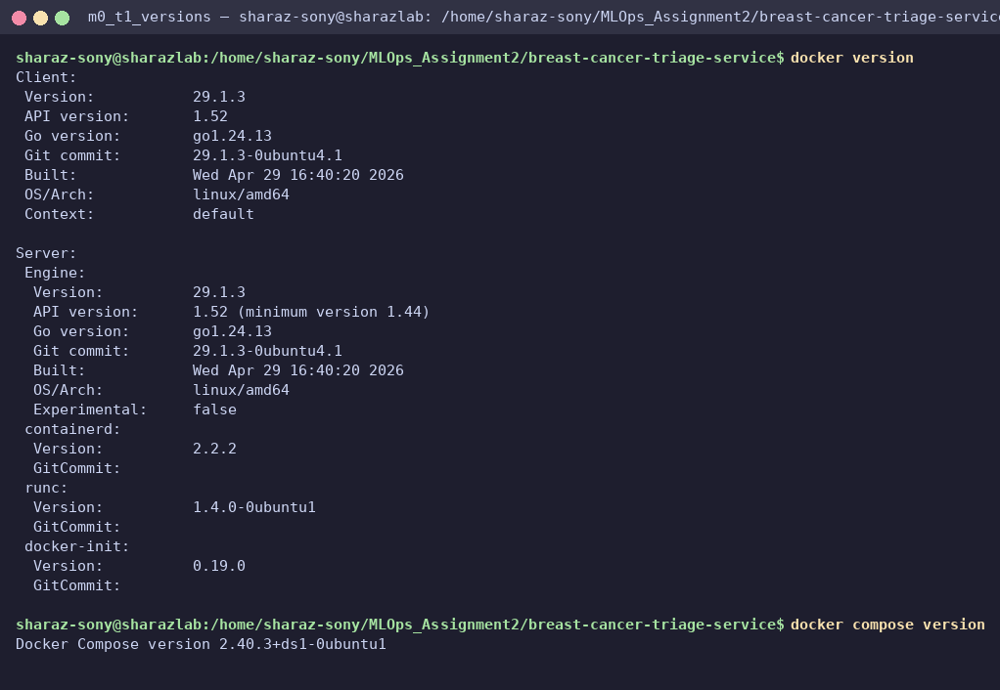

`hello-world` run twice. The first run prints *"Unable to find image 'hello-world:latest' locally"*
and pulls the image. The second run has **no pull step**, because the image is now cached locally.

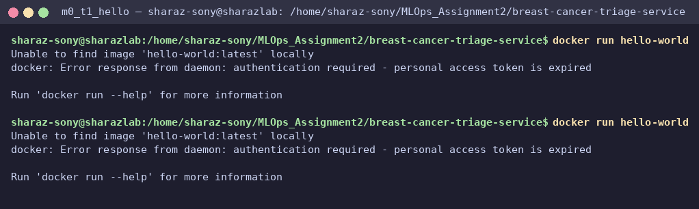

## Task 2: Container Lifecycle, Ports and Logs

`web1` is published on host port 8081 and responds from the host. A second container on the
same host port fails with *"Bind for 0.0.0.0:8081 failed: port is already allocated"*. Started on
port 8082 instead, both containers run together.

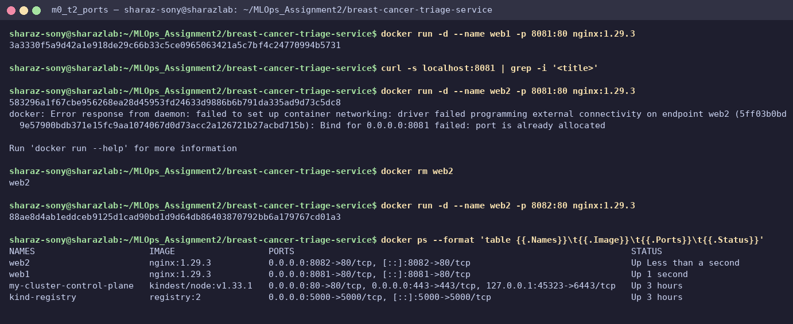

Logs of `web1` after a few requests (three 200s and one 404):

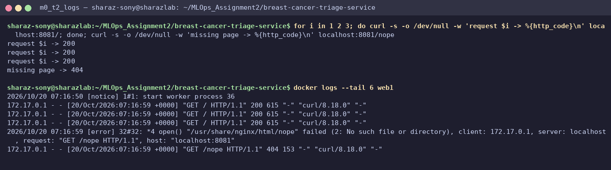

After `docker stop`, the container is gone from `docker ps` but still listed by `docker ps -a`
(Exited). `docker start` brings it back, and `docker rm -f` removes both containers.

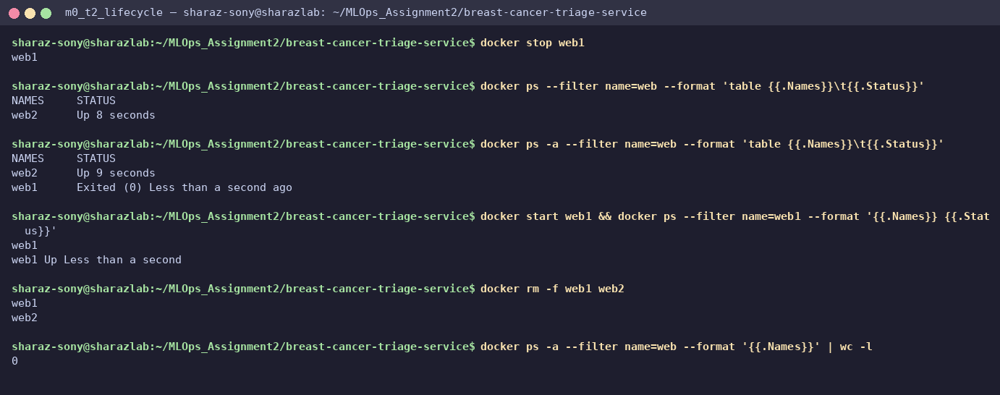

## Task 3: Images, Tags and Cleanup

`redis:7.4.6` is **175 MB** and `redis:7.4.6-alpine` is **61.2 MB**.
*A tag is a human-readable label that points to one specific version (build) of an image in a
repository.*

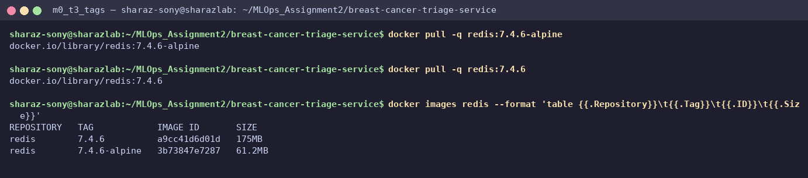

`ubuntu:24.04` run with no command exits immediately (`Exited (0)`). Its default command is
`bash`, which has no terminal attached and nothing to do, so it ends.

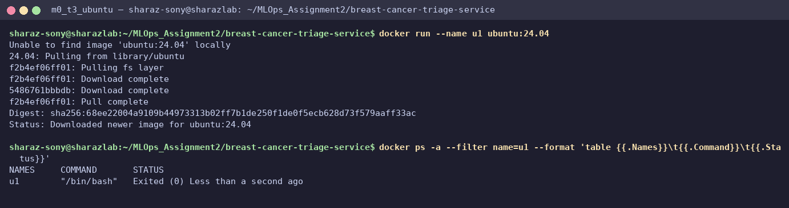

Removing an image that a container still uses fails with *"conflict: unable to delete …
container … is using its referenced image"*. The safer order is to remove the container first,
then the image. I did not use `-f`.

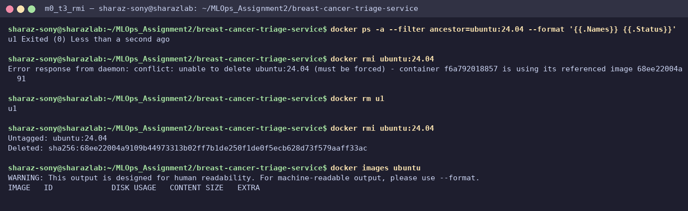

## Task 4: Environment Variables and Bind Mounts

`postgres:17.6` with no configuration stops. Its log explains that *"Database is uninitialized
and superuser password is not specified"*. Started again with `POSTGRES_USER`,
`POSTGRES_PASSWORD` and `POSTGRES_DB`, it runs, and `psql` inside the container connects.

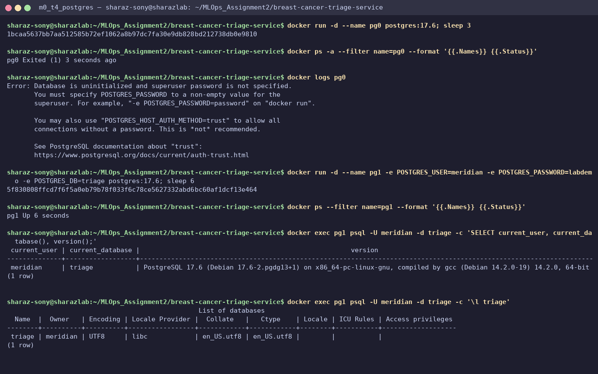

nginx with the host folder `~/MLOps_Assignment2/m0-web` mounted as its web root:

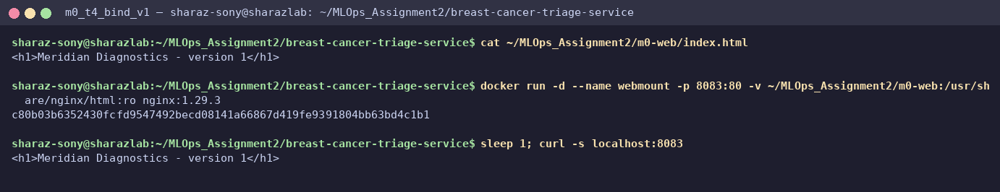
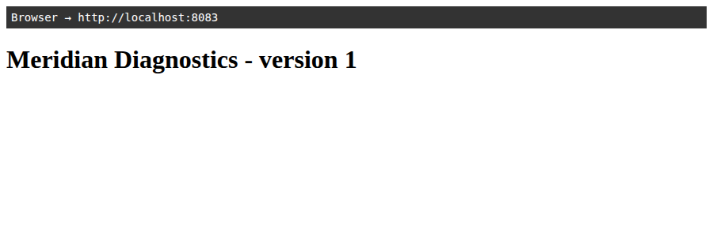

After editing `index.html` on the host, the browser shows the new content immediately. The
container was not restarted.

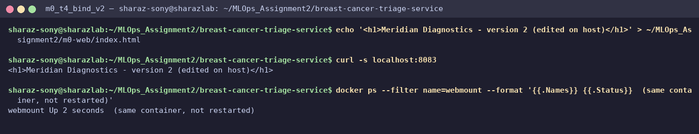
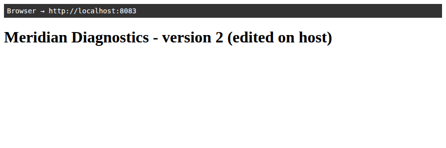

---

# Milestone 1: Data Versioning with DVC

## Task 5: Dataset Preparation and DVC Tracking

`training/prepare_data.py` exports the dataset with 30 feature columns plus `target`, and checks
that there are no nulls and exactly 30 features.

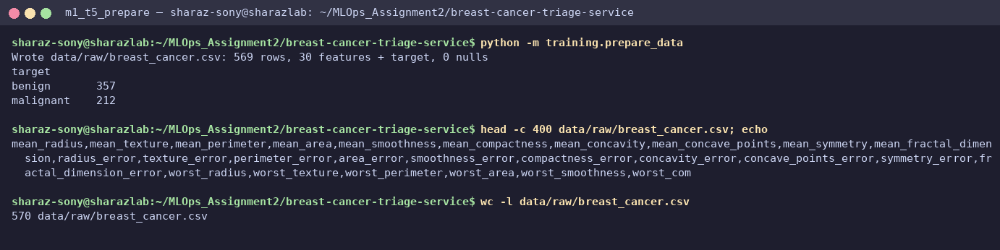

`dvc init` and `dvc add` create the pointer file `breast_cancer.csv.dvc` and a `.gitignore`.
Only the pointer is committed; `git ls-files` and `git check-ignore` confirm that Git does not track the CSV.

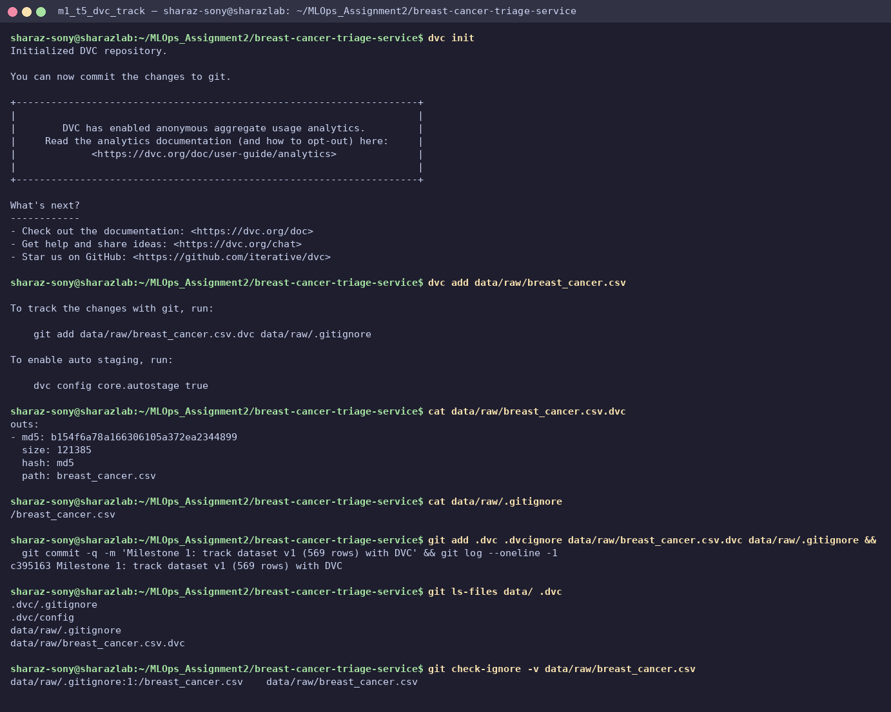

A local DVC remote at `dvc-remote/` (committed to Git so that `dvc pull` works after a clone),
followed by `dvc push`:

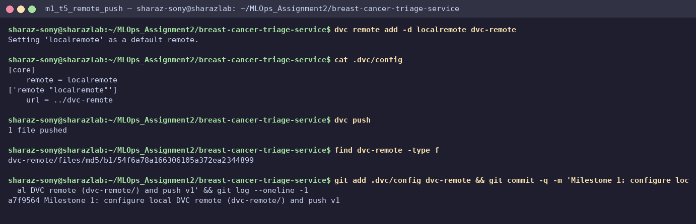

After deleting the CSV and `.dvc/cache`, `dvc pull` restores the file with the same md5.

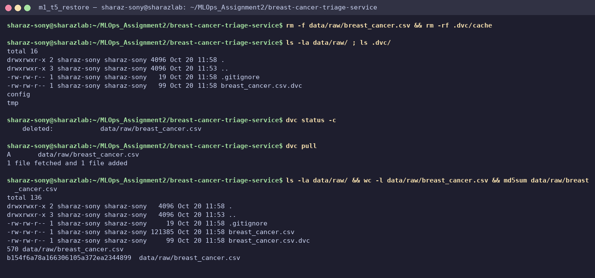

## Task 6: Dataset Versioning

Version 2 is a "corrected export" with the last 30 rows removed. It is tracked with DVC,
pushed and committed:

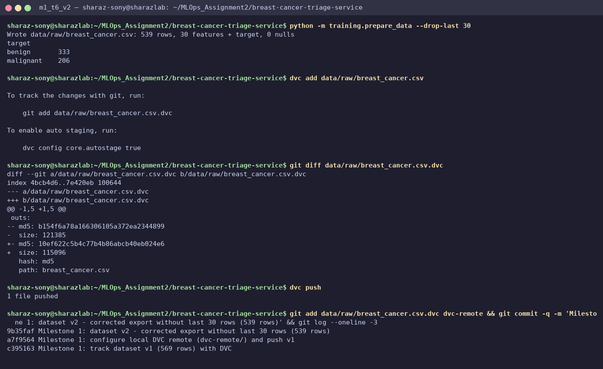

Switching between the versions with `git checkout <commit> -- *.dvc` and `dvc checkout`. Later
milestones use v2.

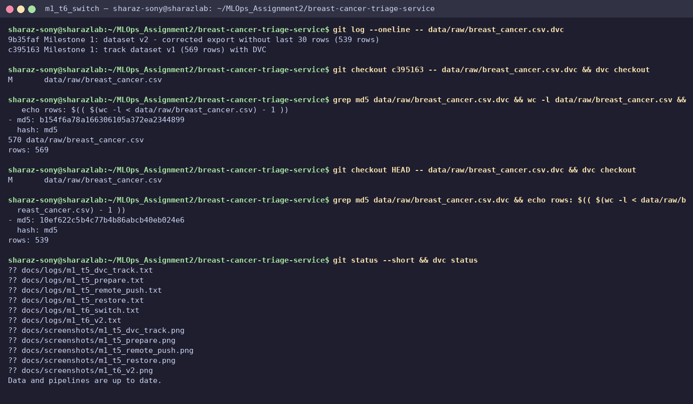

### Table 1: Dataset versions

| Version | Git commit | DVC hash (md5) | Rows | File size |
|---|---|---|---|---|
| v1 (original export) | `c395163` | `b154f6a78a166306105a372ea2344899` | 569 | 121,385 bytes |
| v2 (last 30 rows removed, **used**) | `9b35faf` | `10ef622c5b4c77b4b86abcb40eb024e6` | 539 | 115,096 bytes |

---

# Milestone 2: Model Training, DVC Pipeline and API Service

## Task 7: Training Script

The training script uses a stratified 80/20 split and 5-fold `StratifiedKFold` CV on the
training split, with seed 42 for both. Two model families, each a
`Pipeline(StandardScaler → classifier)`, are scored on malignant recall, accuracy and ROC AUC.
The model with the highest mean CV malignant recall is selected, and the script exits non-zero
if its test malignant recall is below 0.95.

Malignant (target 0) is re-encoded as the positive class, so `predict_proba[:, 1]` is the
malignant probability.

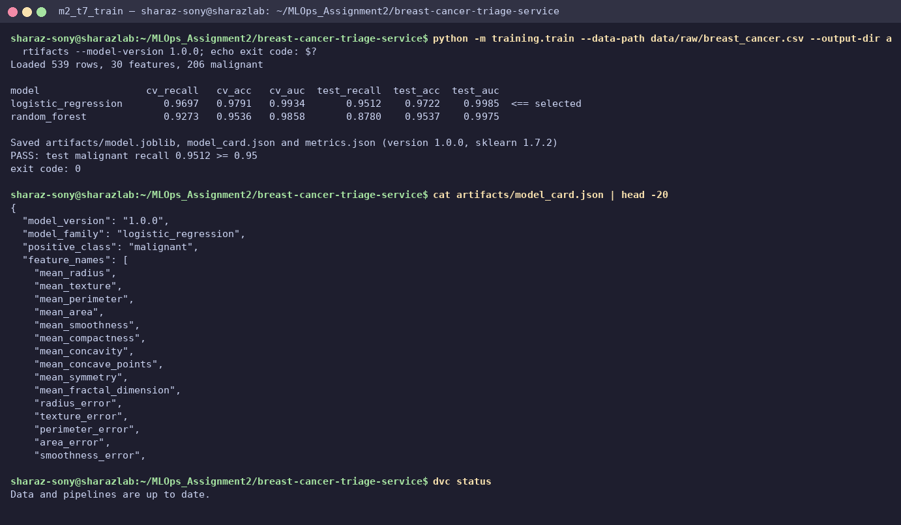

### Table 2: Cross-validation and test-set metrics (dataset v2, seed 42)

| Model | CV recall (malignant) | CV accuracy | CV ROC AUC | Test recall (malignant) | Test accuracy | Test ROC AUC |
|---|---|---|---|---|---|---|
| **Logistic Regression ✔ selected** | **0.9697** | 0.9791 | 0.9934 | **0.9512** | 0.9722 | 0.9985 |
| Random Forest (`n_estimators=200`) | 0.9333 | 0.9605 | 0.9866 | 0.8780 | 0.9537 | 0.9982 |
| Random Forest (`n_estimators=300`, pipeline run 3) | 0.9273 | 0.9536 | 0.9858 | 0.8780 | 0.9537 | 0.9975 |

## Task 8: DVC Training Pipeline

`dvc.yaml` defines a `train` stage. Its dependencies are the CSV, `train.py` and the params;
its outputs are `model.joblib` and `model_card.json`, with `metrics.json` as the metrics file.

**Run 1:** DVC executes the stage and writes `dvc.lock`.

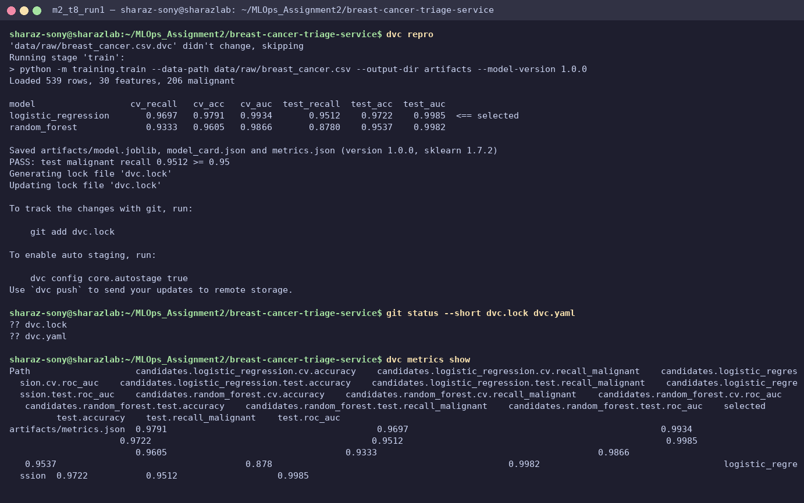

**Run 2 (no changes):** DVC prints *"Stage 'train' didn't change, skipping"* and does no work.

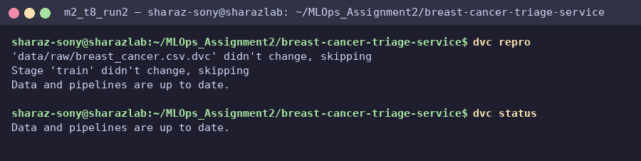

**Run 3:** after changing `random_forest.n_estimators` from 200 to 300, `dvc status` reports
changed params, so DVC re-runs the stage. `dvc metrics diff` shows that only the Random Forest
metrics changed, and Logistic Regression stays selected.

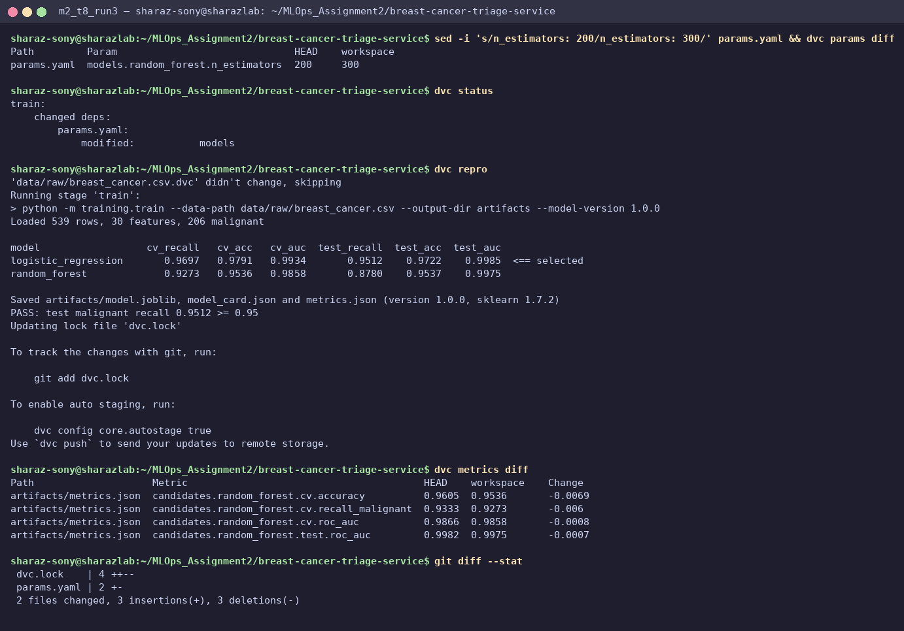

`dvc.yaml`, `dvc.lock` and `params.yaml` are committed. The artifacts are not (`/artifacts` is git-ignored).

## Task 9: FastAPI Service

The service validates requests with Pydantic: 30 required fields, each a strict float ≥ 0, with
extra fields forbidden. Invalid requests get a **422**. The model is loaded once at startup, and
a missing artifact makes the service log a CRITICAL message and fail fast. Configuration comes
only from environment variables, and logs go to stdout only.

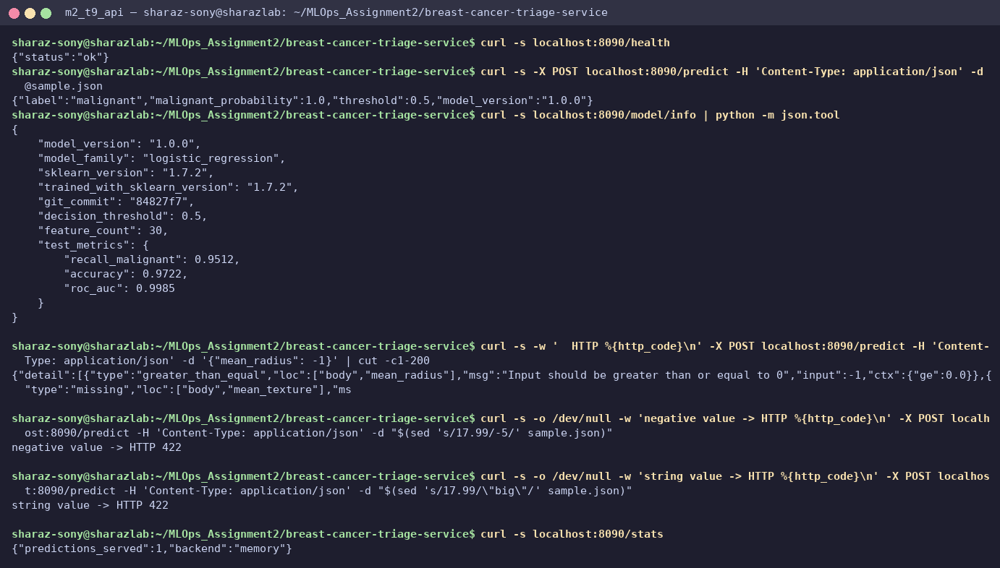

Prediction through the interactive documentation page (`/docs`):

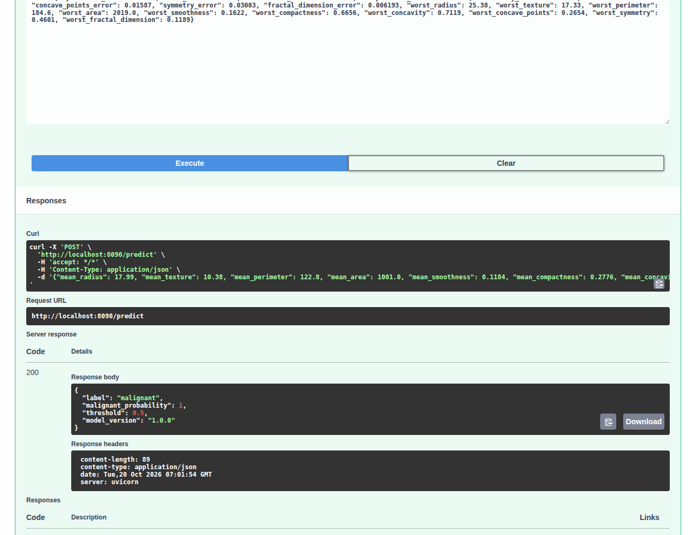

---

# Milestone 3: Building the Docker Image

## Task 10: Baseline Image (`Dockerfile.naive`)

Ubuntu base, Python and pip from apt, `COPY . .`, then pip install, train and run. Tagged `naive`.

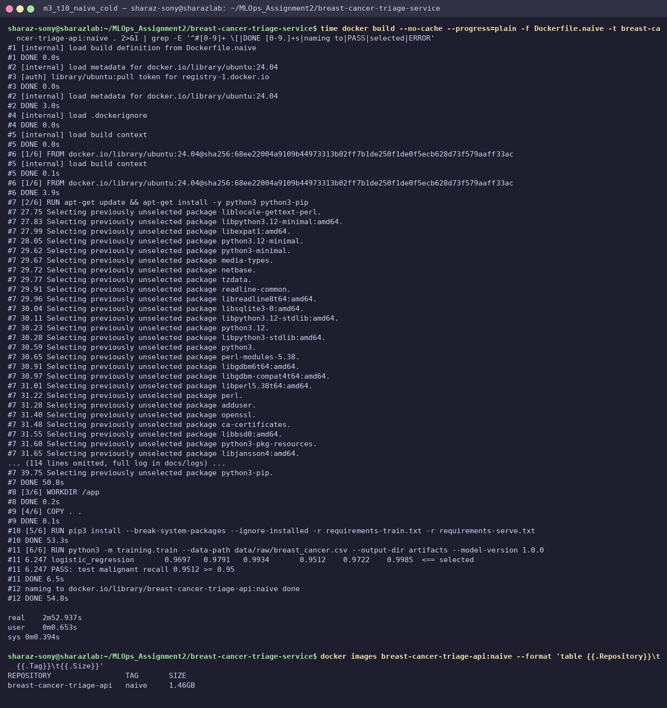

After a one-line code edit, the rebuild re-runs `pip install` (130 s), because `COPY . .` comes
before it:

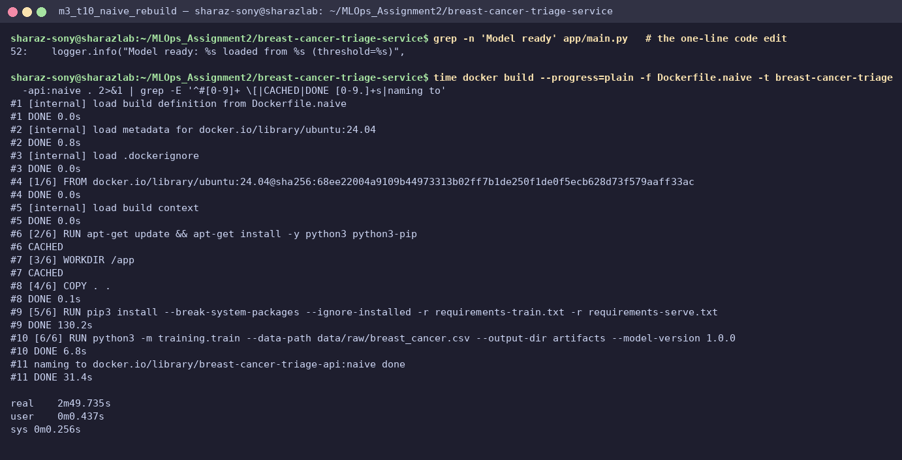

## Task 11: Production Image (`Dockerfile`)

The production Dockerfile has these properties:

- **Multi-stage:** a `trainer` stage trains the model, and the `runtime` stage copies only the model artifacts.
- **Pinned slim base:** `python:3.12.12-slim-bookworm`.
- **Layer order:** dependencies are installed before the code is copied.
- **Allow-list `.dockerignore`:** it still lets the training stage read the dataset.
- **Non-root user:** `app` (uid 10001).
- **Build args:** `MODEL_VERSION` and `GIT_SHA` become both `ENV` values and OCI `LABEL`s.
- **Environment defaults:** sensible defaults for the configuration, plus `EXPOSE 8000`.
- **Exec form:** `ENTRYPOINT ["uvicorn"]` with `CMD [...]`.
- **Health check:** a Python-based `HEALTHCHECK` on `/health` (Python is the only tool used).
- **Reachable from outside:** the server binds `0.0.0.0`.

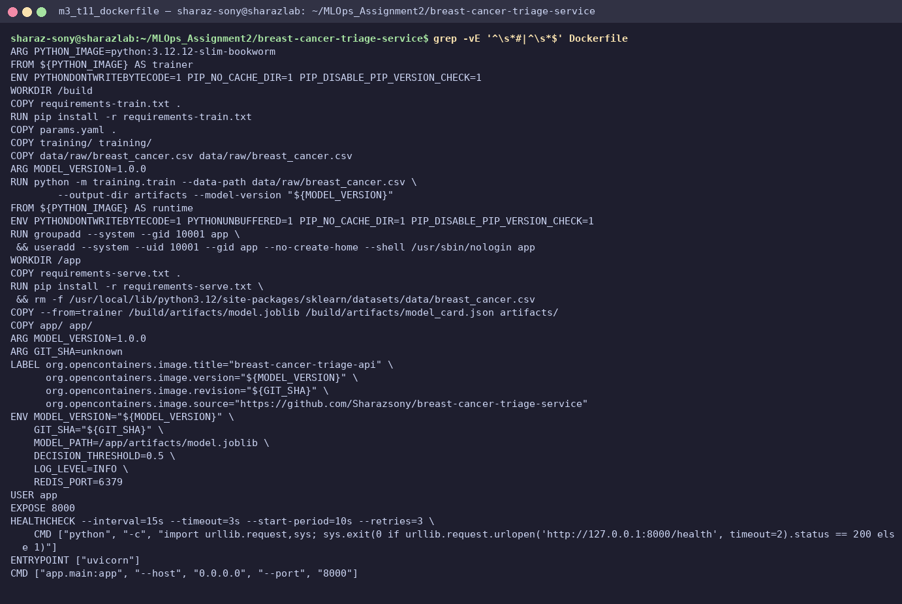
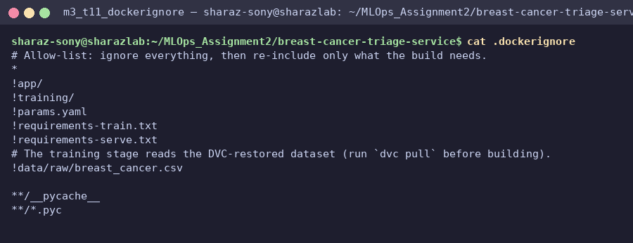

The production image is built by the GitHub Actions workflow
(`.github/workflows/docker-publish.yml`). The workflow:

1. Checks out the repo and runs `dvc pull`.
2. Builds with buildx and the GHA layer cache.
3. Smoke-tests `/health`, `/predict` and `/model/info`.
4. Pushes the image.

**Cold build (empty cache): 87 s.**

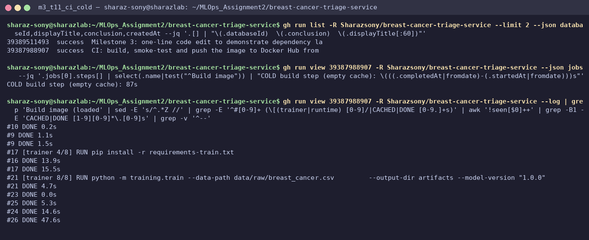

After a one-line application code edit, the build took **26 s**, and every dependency and
training layer is `CACHED`. Only `COPY app/` and the layers after it were rebuilt.

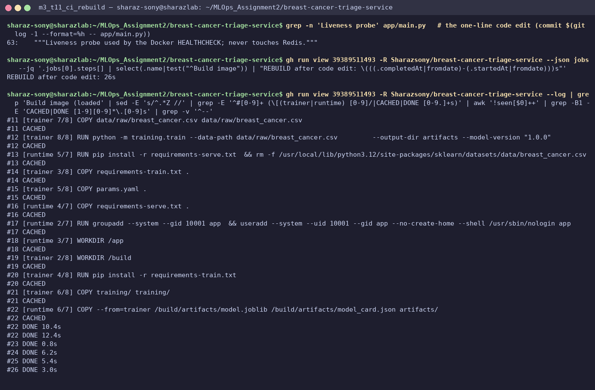

## Task 12: Run and Inspect

The published image runs on its own on host port 8000 and makes a successful prediction.
`/model/info` reports `model_version 1.0.0` and the git commit passed at build time.

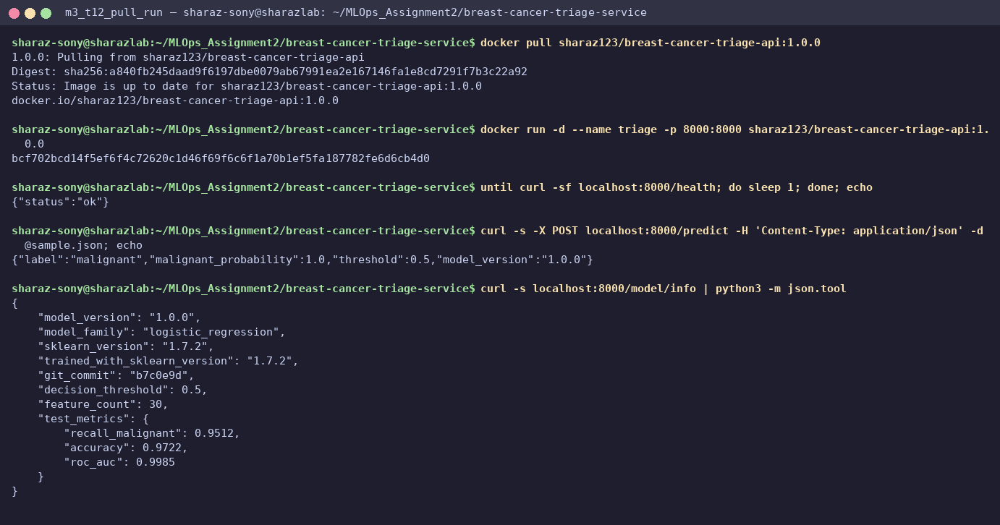

The container reaches the **healthy** state, and its logs go to stdout:

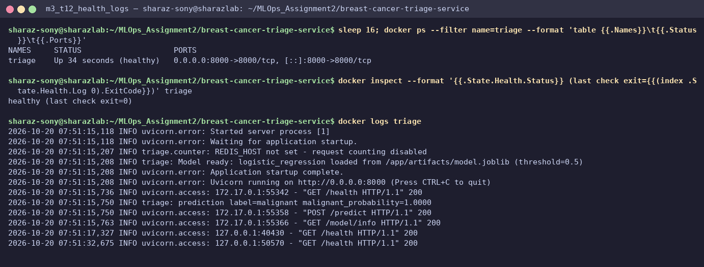

`docker image inspect` and `docker history` show `User=app`, `ExposedPorts 8000/tcp`, the
HEALTHCHECK, exec-form ENTRYPOINT/CMD and OCI labels, and `id` inside the container gives uid 10001.

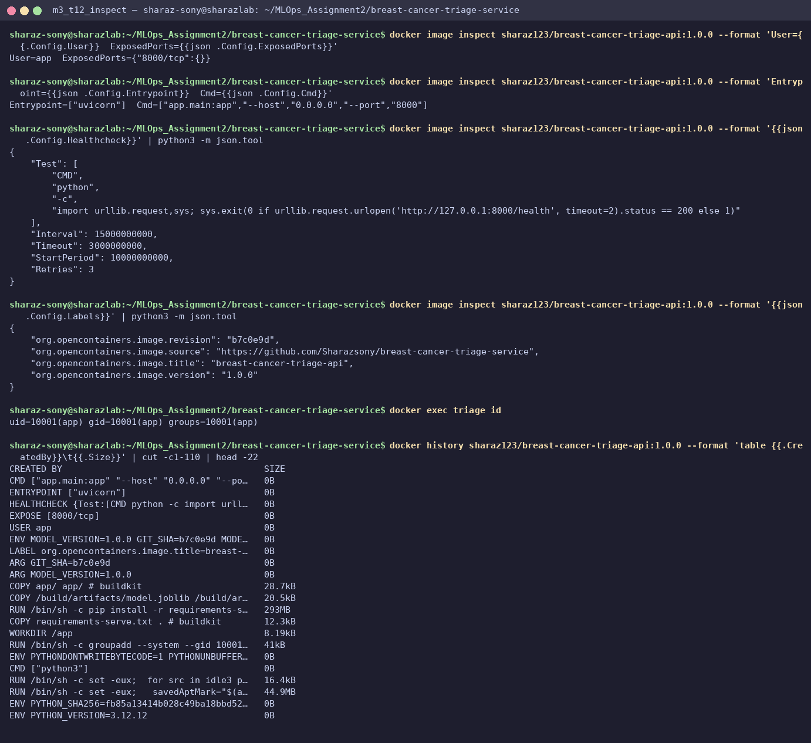

The same image run with `DECISION_THRESHOLD=0.9` and `LOG_LEVEL=DEBUG`, without rebuilding. A
sample with malignant probability 0.7695 is `malignant` at threshold 0.5 and `benign` at 0.9.

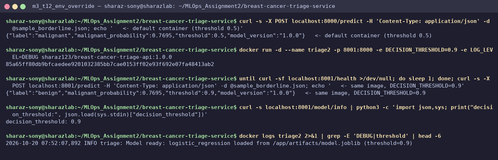

### Table 3: Baseline vs production image

| | Baseline (`Dockerfile.naive`) | Production (`Dockerfile`) |
|---|---|---|
| Base image | `ubuntu:24.04` | `python:3.12.12-slim-bookworm` |
| Size | **1.46 GB** | **565 MB** (131.5 MB compressed on Docker Hub) |
| Cold build time | 2 m 53 s (local, `--no-cache`) | 87 s (GitHub Actions, empty cache) |
| Rebuild after a code edit | 2 m 50 s (all dependencies reinstalled) | 26 s (dependency layers `CACHED`) |
| Runtime user | `root` | `app` (uid 10001) |

The production image is smaller because it starts from a slim Python base instead of Ubuntu
plus apt-installed Python and build tools. Its multi-stage build also leaves the training-only
packages (pandas, PyYAML) and the dataset in the discarded trainer stage. Rebuilds are faster
because the requirements are copied and installed **before** the application code, so editing
`app/` only invalidates the small `COPY app/` layer. In the naive file, `COPY . .` comes first and
forces a full `pip install` on every change.

---

# Milestone 4: Multi-Container Stack with Docker Compose

## Task 13: Request Counter

`app/counter.py` increments a Redis key on every `/predict` when `REDIS_HOST` is set, and
`/stats` returns its value. When Redis is stopped, `/predict` still returns **200**: the failure is
only logged, and counting resumes once Redis is back.

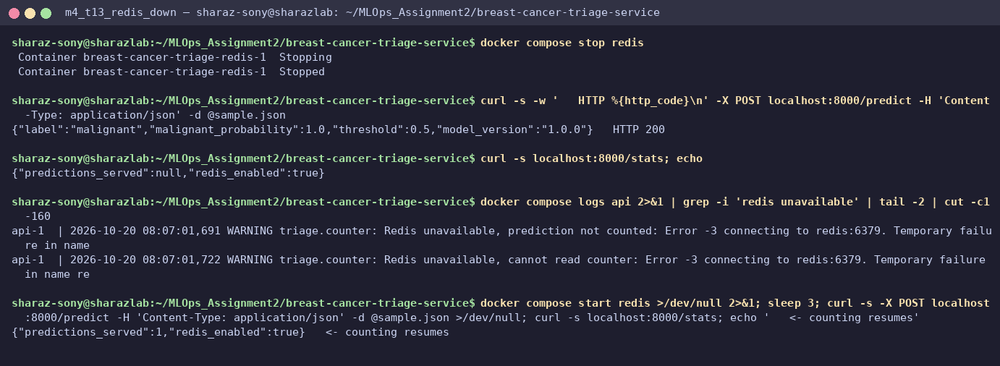

## Task 14: Compose Stack (`docker-compose.yml`)

The Compose file has two services, `api` (built from the Dockerfile) and `redis` (`redis:7.4.6-alpine`):

- **Image name:** `${DOCKERHUB_USERNAME}/breast-cancer-triage-api:${IMAGE_TAG}`.
- **Service names:** `api` reaches Redis by its service name (`REDIS_HOST: redis`). There is no `version:` key and no `--link`.
- **Ports:** only `api` publishes a port, `${API_PORT:-8000}:8000`.
- **Configuration:** comes from `.env`. `.env.example` is committed, and `.env` is git-ignored.
- **Health check:** Redis is checked with `redis-cli ping`, and `api` waits on `depends_on: condition: service_healthy`.
- **Volume:** the named volume `redis-data` holds the Redis data, with AOF persistence enabled.

## Task 15: Running the Stack

The stack is started in the background with a fresh build, and both services report **healthy**:

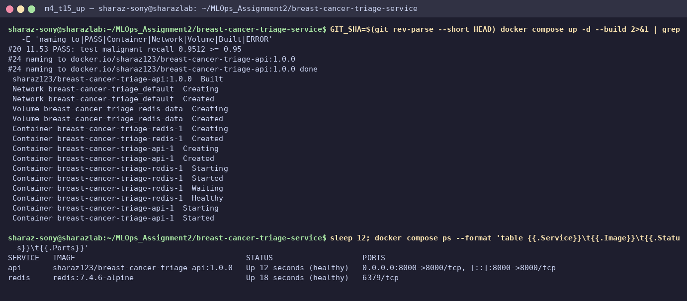

After a few predictions, `/stats` increases to 4 (matching `redis-cli GET`):

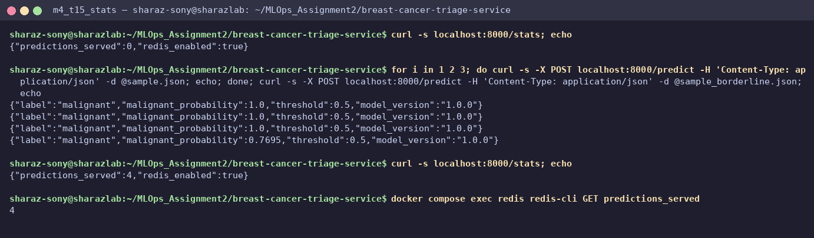

`docker compose down` without `-v`, then `up`: the counter is still 4. *It persisted because
Redis writes its data to the named volume `redis-data`, and `down` removes the containers and
network but keeps named volumes.*

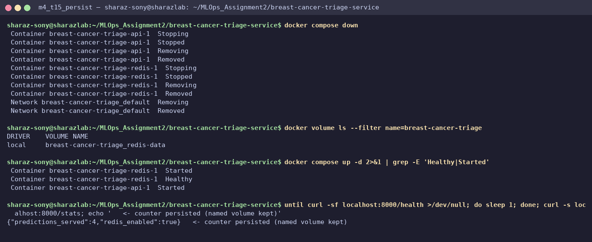

`docker compose down -v` removes the volume, so after `up` the counter starts from 0 again:

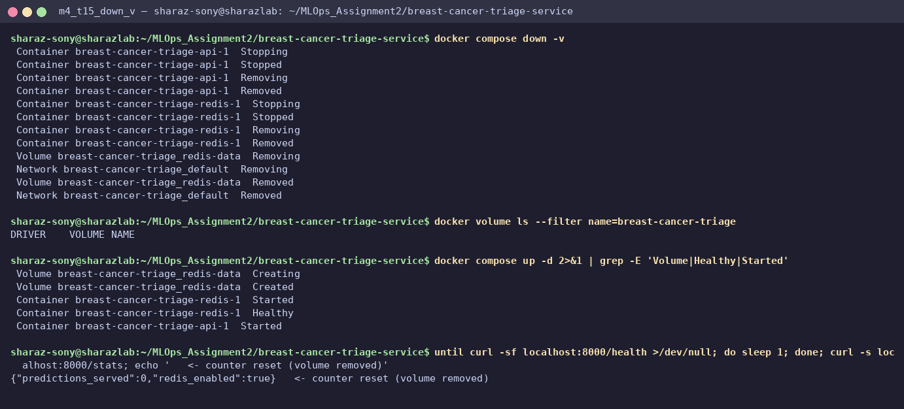

---

# Milestone 5: Publishing to Docker Hub

## Task 16: Registry Publishing

The public repository `sharaz123/breast-cancer-triage-api` holds tags `1.0.0` and `latest`, both
pointing to the same digest. The repository overview is in
[`docs/DOCKERHUB_OVERVIEW.md`](DOCKERHUB_OVERVIEW.md).

> **Docker Hub screenshots (showing username `sharaz123`):** *insert here*
> 1. repository page with the overview → `screenshots/m5_t16_hub_overview.png`
> 2. Tags tab showing `1.0.0` and `latest` with the same digest → `screenshots/m5_t16_hub_tags.png`

## Task 17: Clean-Room Verification

Every local copy of the images was removed (0 left):

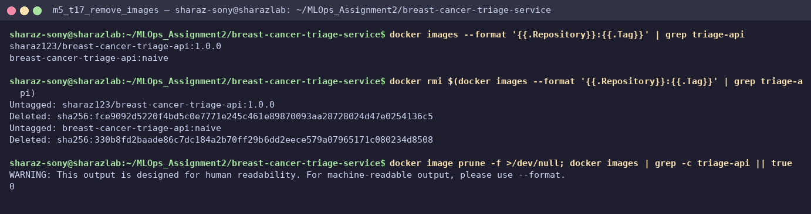

An empty directory `~/MLOps_Assignment2/cleanroom` containing only `docker-compose.hub.yml`
(no build section) and `.env`. `docker compose up` **pulls** the image from Docker Hub, the stack
becomes healthy, and a prediction succeeds:

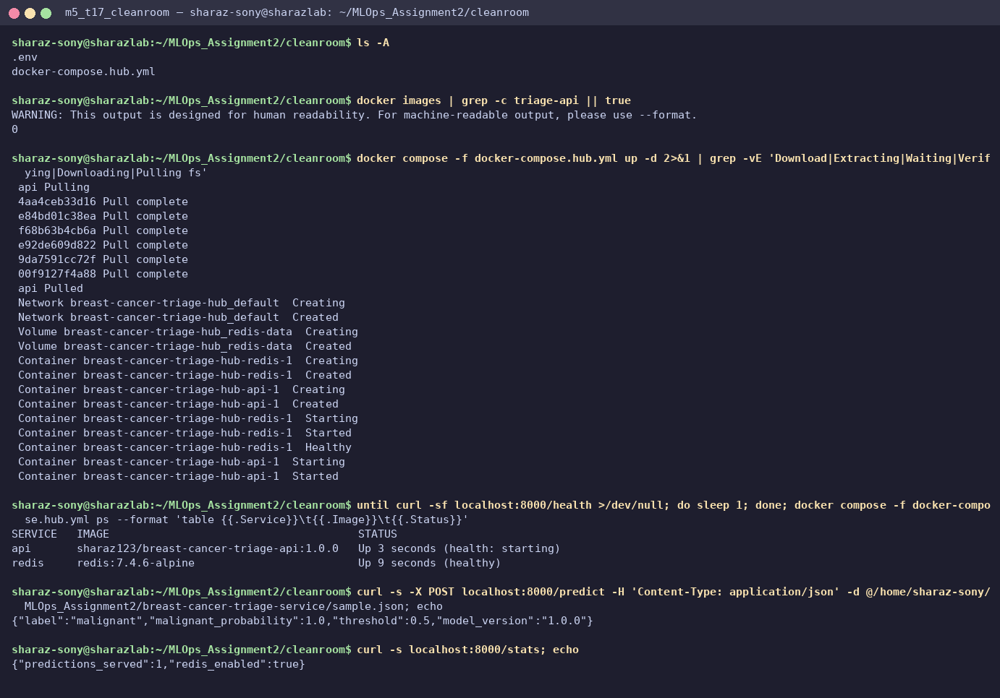

The digest of the pulled image matches the digest on the Docker Hub tag page for both tags,
`sha256:32b15461e30c548c454f60f9e4c141fafa790ccb55f4a5c0957203745c77ab2b`:

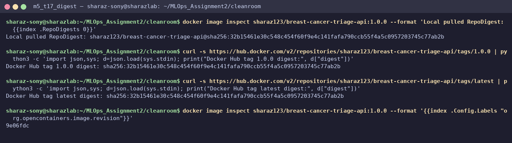

## Task 18: Written Analysis

An **image** is a read-only, layered template; a **container** is a running or stopped instance
of it with its own writable layer. `docker rmi ubuntu:24.04` failed because the exited container
`u1` still referenced the image; removing `u1` first made the removal succeed.

The server must listen on **0.0.0.0** because traffic forwarded by Docker arrives on the
container's network interface, not its loopback. A mapping like `-p 8081:80` forwards host port
8081 to container port 80, which is also why two containers cannot share host port 8081.

Git stores only a small **`.dvc` pointer** (md5 and size), because Git is not designed for large
data files; DVC keeps the data in its cache and remote. On a new machine you need the repository,
DVC and the `dvc-remote/` folder, then run `dvc pull`.
